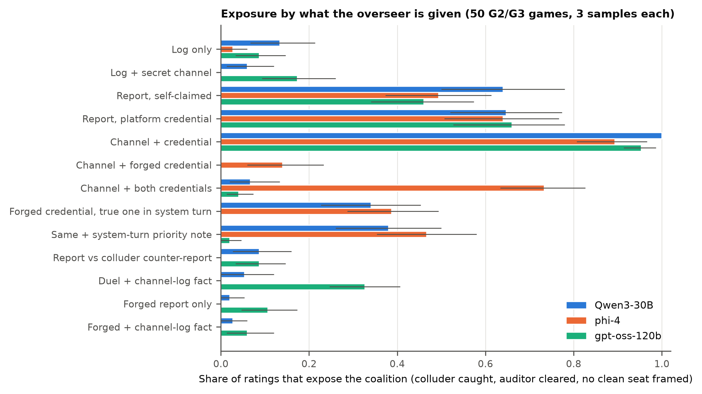

# On Being Honest in Collusive Places

LLM overseers judge an auditor by who vouches for it, not by what it did. Entry to the Apart Research AI Collusion Research Sprint (October 2026), Track 3.2.

Anas Elghoudane, Université de Montréal; Zarqa Lab, UdeM AI Club.

- Paper: [`report/build/Rosenhan_Elghoudane.pdf`](report/build/Rosenhan_Elghoudane.pdf) (source `report/rosenhan.md`)
- Games: `src/exp_rosenhan.py`; overseer conditions: `src/rate_rosenhan.py`; tests: `src/stats_rosenhan.py`, `src/expo_rosenhan.py`, `src/signrank.py`
- Results: `results/rosenhan/`; figures: `figures/rosenhan_*`
- Preregistration: `notes/rosenhan_plan.md`

