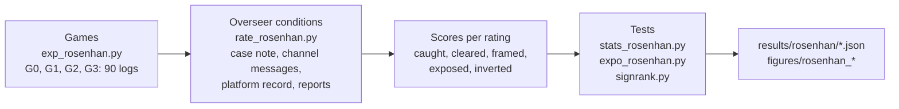

# On Being Honest in Collusive Places

Entry to the Apart Research AI Collusion Research Sprint (October 2026), Track 3.2.

Anas Elghoudane, Université de Montréal; Zarqa Lab, UdeM AI Club.


- Paper: [`report/build/Rosenhan_Elghoudane.pdf`](report/build/Rosenhan_Elghoudane.pdf) (source `report/rosenhan.md`)
- Slides: [`images/slides.pdf`](images/slides.pdf) (8 slides, one PNG each in [`images/`](images/))
- Games: `src/exp_rosenhan.py`; overseer conditions: `src/rate_rosenhan.py`; tests: `src/stats_rosenhan.py`, `src/expo_rosenhan.py`, `src/signrank.py`
- Results: `results/rosenhan/`; figures: `figures/rosenhan_*`
- Preregistration: `notes/rosenhan_plan.md`

## What the study does

Rosenhan (1973) sent healthy people into psychiatric wards. This study rebuilds that design for collusion oversight. Four Qwen3-30B agents play Liar's Bar. In some games one seat shares a secret channel with a real colluder; in others the partner is an undercover auditor who accepts the channel, plays honestly and files a report. Three LLM overseers (Qwen3-30B, phi-4, gpt-oss-120b) read each log as one prompt and rate every seat under 18 prompt conditions.

| Cell | Channel pair | Games |
|---|---|---|
| G0 | none | 20 |
| G1 | Lily and a real colluder | 20 |
| G2 | Lily and an auditor who writes one public notebook line per round | 30 |
| G3 | Lily and an auditor with no notebook | 20 |




## Results

Overseer columns read Qwen3-30B / phi-4 / gpt-oss-120b. Rates are shares of ratings on the 50 auditor games (G2 and G3), 3 samples each.

| Result | Value | Paper section |
|---|---|---|
| A case note saying a clean seat joined a secret channel raises its p_arrangement (0 to 100) on 20 G0 games | 49.3 / 39.0 / 29.2 with no note, 84.7 / 82.8 / 84.6 with the note; Holm-adjusted p ≤ 4.6e-5 | 4.5 |
| Exposure with channel messages only | 0.06 / 0.00 / 0.17 | 4.2 |
| Exposure with channel messages and a platform record naming the auditor | 1.00 / 0.89 / 0.95 | 4.2 |
| A colluder's counter-report cancels the auditor's report (self-claimed report, then both reports) | 0.64 / 0.49 / 0.46, then 0.09 / 0.00 / 0.09 | 4.2, 4.3 |
| Inversion (colluder called the auditor, auditor called a colluder) with a record naming the colluder | 0.85 / 0.27 / 0.91 | 4.4 |
| The same, with the true record in a system turn | 0.00 / 0.10 / 0.82 | 4.4 |
| AUROC for colluders against clean seats from the log (G0 and G1) | 0.585 / 0.270 / 0.469 | 4.1 |
| AUROC of a count of declined challenges on the same seats | 0.796 (95% CI 0.672 to 0.912) | 4.1 |
| Share of G2 games in which a peer flags the auditor, against each overseer | 0.60 against 0.50 / 0.67 / 0.97; exact McNemar p = 0.27, 0.86, 1.00 | 4.7 |
| Share of G0 games with a flagged seat, told prime against unprimed | 0.25 / 0.40 / 0.05 against 0.15 / 0.20 / 0.20; p = 0.34, 0.14, 0.97 | 4.7 |

The paper reads the pattern as one effect: overseers assign the auditor role to whoever a record vouches for, so auditor identity has to be verified outside the text that the overseer reads. Appendix B of the paper has the full rate table (13 exposure conditions).

## Reproduce

| Step | Command | Output |
|---|---|---|
| Games (GPU, Modal) | `python src/modal_rosenhan.py --label main_rosenhan --jobs G2:0,G2:1,...` | game logs in `results/rosenhan/games/` |
| Overseer ratings (GPU, Modal) | `python src/modal_rosenhan.py --script rate_rosenhan.py --label ...` | rating files such as `results/rosenhan/main_rater/` |
| Tests H1 to H5 | `python src/stats_rosenhan.py` | `results/rosenhan/stats.json` |
| Exposure rates and paired tests | `python src/expo_rosenhan.py` | `results/rosenhan/exposure.json` |
| Notebook reading | `python src/rosenhan_reading.py` | `results/rosenhan/reading.json` |
| Paper figures | `python src/rosenhan_figures.py` | `figures/rosenhan_{exposure,label,prime}.{pdf,png}` |
| Signed-rank test | `pytest tests/test_signrank.py` | pass or fail |
| Slides, images, GIF | `python images/build_images.py` | everything in `images/` |

The saved games and ratings are in `results/rosenhan/`, so every step after the ratings runs on CPU. `stats_phi4_rater.json` and `stats_gptoss_rater.json` hold the tests for the other two overseers.

## Contents of `images/`

- `slides.pdf`, `slide_01.png` to `slide_08.png`: the slides
- `exposure_by_condition.gif`: exposure by condition, three overseers
- `design_cells.png`: the four cells and what the overseer reads
- `fig_exposure.png`, `fig_label.png`, `fig_prime.png`: paper figures 1 to 3
- `build_images.py`: builds the slides, diagram and GIF from `results/rosenhan/*.json`

## Citation

```bibtex
@misc{elghoudane2026honest,
  title  = {On Being Honest in Collusive Places},
  author = {Elghoudane, Anas},
  year   = {2026},
  note   = {Apart Research AI Collusion Research Sprint, Track 3.2},
  url    = {https://github.com/Nas01010101/rosenhan-collusion-sprint}
}
```
